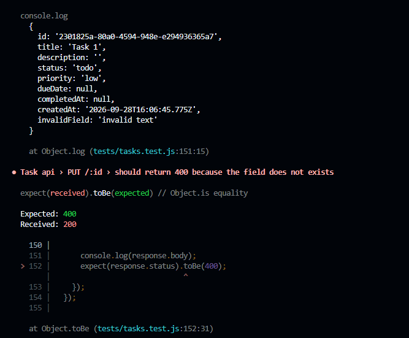
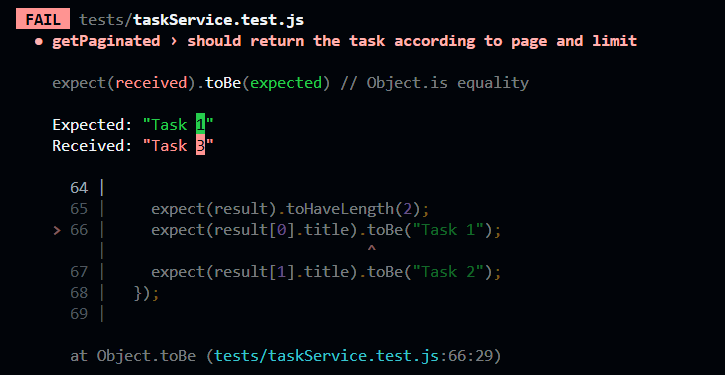

# Bug Report

## Bug 1 — Unknown fields accepted during task update

**Location:** `src/utils/validators.js`, inside `validateUpdateTask()`.

### Expected behavior

The API should reject fields that are not part of the task schema
and return HTTP 400.

### Actual behavior

PUT /tasks/:id accepts unknown fields and returns HTTP 200.
The unknown field is added to the task object.

### How it was discovered

An integration test sent an update request containing an
unsupported field and expected a 400 response. The API instead
returned 200 and included the unknown field in the updated task.

### Proposed fix

We can define the valid fields inside validators.js and then update the `validateUpdateTask()` to validate the allowed fields and return an error when an unknown field is provided.

## Bug 2 — Pagination uses an incorrect page offset

**Location:** `src/services/taskService.js`, in the pagination offset calculation.

### Expected behavior

When using 1-based pagination, requesting page = 3 with limit = 1 should return the third task.

### Actual behavior

The getPaginated() function calculates the offset as:

const offset = page \* limit;

This makes page = 3, limit = 1 start from index 3, returning Task 4 instead of Task 3.

### How it was discovered

The following test exposed the bug:

    const result = taskService.getPaginated(1, 2);
    expect(result).toHaveLength(2);
    expect(result[0].title).toBe("Task 1");
    expect(result[1].title).toBe("Task 2");

The test fails because the function returns Task 3.

### Proposed fix

Since pagination uses 1-based page numbers, calculate the offset using:

const offset = (page - 1) \* limit;

This makes page 1 start at index 0, page 2 at index limit, and so on.
