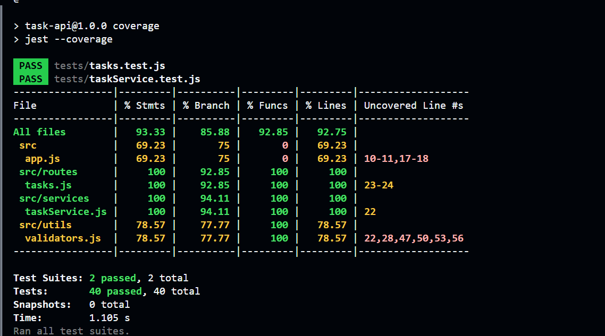

# Submission Notes

## Overview

This assignment involved testing an existing Task Manager API, identifying bugs through testing, fixing one of the bugs, and adding a new task-assignment feature.

The project was tested using Jest and Supertest, with unit tests for the task service and integration tests for the API routes.

---

## Testing

I added tests covering:

- Task creation
- Task retrieval
- Task updates
- Task deletion
- Task completion
- Task filtering
- Pagination
- Task statistics
- Validation and invalid inputs
- Error cases
- Task assignment

Both unit-level and API-level behavior were tested.

### Test Results

- **Test suites:** 2 passed
- **Tests:** 40 passed
- **Snapshots:** 0

### Coverage

The final coverage results were:

| Metric     | Coverage |
| ---------- | -------: |
| Statements |   93.33% |
| Branches   |   85.88% |
| Functions  |   92.85% |
| Lines      |   92.75% |

### Coverage Screenshot

<!-- Upload/paste the coverage screenshot below this line -->



---

## Bugs Found (Detailed explanation in BUG_REPORT.md)

### Bug 1 — Unknown fields accepted during task update

**Location:** `src/utils/validators.js`, inside `validateUpdateTask()`.

**Expected behavior:**
The update endpoint should reject fields that are not supported by the task schema.

**Actual behavior:**
The update endpoint accepted unsupported fields and added them to the task object.

**How it was discovered:**
I identified this through an integration test that sent an unsupported field and expected a `400` response.

**Why it happened:**
The update validator performed validation on supported fields but did not explicitly reject unknown fields supplied in the request body.

**Fix:**
I updated `validateUpdateTask()` to check the request body against a list of allowed update fields and reject unknown fields before performing the existing field-specific validation.

---

### Bug 2 — Pagination off-by-one error

**Location:** `src/services/taskService.js`, in the pagination offset calculation.

**Expected behavior:**
Pagination uses 1-based page numbers, so page 1 should start at offset `0`, page 2 should start at offset `limit`, and so on.

**Actual behavior:**
The implementation calculated the offset using:

```js
const offset = page * limit;
```

For example, requesting page 3 with a limit of 1 returns Task 4 instead of Task 3.

**How it was discovered:**
The behavior was identified while testing paginated task retrieval.

**Why it happened:**
The calculation treated the page number as if it were zero-based, even though the API uses 1-based page numbers.

**What the fix would look like:**

```js
const offset = (page - 1) * limit;
```

This bug was documented in the bug report but was not selected as the bug fixed for this assignment.

---

## Bug Fix

I fixed the unknown-field validation bug.

The validator now checks whether every field supplied in an update request is an allowed task field before performing the existing field-specific validation.

This prevents unsupported properties from being added to task objects through the update endpoint.

---

## New Feature — Task Assignment

I added the following endpoint:

```http
PATCH /tasks/:id/assign
```

Request body:

```json
{
  "assignee": "Vinay"
}
```

The endpoint:

- Accepts an assignee name.
- Stores the assignee on the task.
- Returns the updated task.
- Returns `404` when the task does not exist.
- Validates that the assignee is a non-empty string.
- Handles the case where a task is already assigned.

### Design Decisions

The assignee is validated as a non-empty string so that invalid or empty values cannot be stored on a task.

The endpoint checks whether the task exists before attempting to update it, allowing it to return an appropriate `404` response for unknown task IDs.

The behavior for an already-assigned task is explicitly handled rather than silently ignoring the request or creating an inconsistent task state.

Tests were added for the successful assignment flow as well as validation and error cases.

---

## What I Would Test Next

- Pagination with invalid page and limit values.
- Pagination beyond the available number of tasks.
- Updating every supported task field individually.
- More combinations of invalid update fields.
- Behavior with empty or malformed request bodies.
- Additional combinations of task status, priority, and due dates.

I would also test the API with larger numbers of tasks to verify pagination and statistics behavior under more realistic data sizes.

---

## What Surprised Me

Writing tests exposed issues that were not immediately obvious from reading the implementation, particularly the pagination offset behavior and the ability to add unknown fields during updates.

The assignment also highlighted the difference between testing expected API behavior and simply testing whether the existing implementation runs without errors.

---

## Questions I Would Ask Before Shipping to Production

Before shipping the API to production, I would clarify:

- What should the exact pagination behavior be for invalid or out-of-range pages?
- Should tasks be allowed to be reassigned?
- What should happen when an already-assigned task receives another assignee?
- What authentication and authorization rules should apply to task operations?
- Should task data eventually be persisted in a database instead of the current in-memory store?
- What validation rules should apply to dates and other task fields?
- Should there be a user feature so that a person can only access their own tasks?

---
